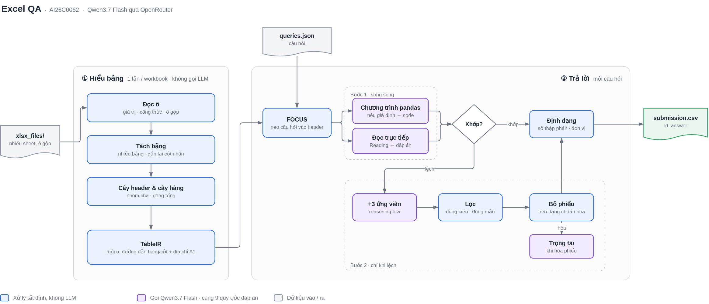

# AI26C0062 – Hỏi đáp trên bảng tính Excel

Giải pháp cho đề thi AI2026, Chủ đề 2 "Hỏi đáp trên bảng tính Excel". Hệ thống trả lời câu hỏi ngôn ngữ tự nhiên (tiếng Anh, Việt, Hàn, Trung…) trên các file `.xlsx` có header nhiều tầng, ô gộp, nhiều bảng trên một sheet hoặc nhiều sheet. LLM dùng **Qwen3.7 Flash (`qwen/qwen3.7-flash`) qua OpenRouter**, đúng yêu cầu của đề.

## 1. Chạy bằng Docker (cách chấm thi)

`Dockerfile` nằm ở thư mục gốc. Ảnh chạy trên Linux amd64, không dùng GPU, chứa sẵn mã nguồn và thư viện. Khóa API **không** nằm trong ảnh; truyền vào lúc chạy.

```bash
docker build --platform linux/amd64 -t ai26c0062 .

docker run --rm \
  -v "/đường/dẫn/test":/input:ro \
  -v "/đường/dẫn/output":/output \
  ai26c0062 \
  --xlsx-dir /input/xlsx_files \
  --queries /input/queries.json \
  --output /output/submission.csv \
  --openrouter-key <khóa OpenRouter> \
  --openrouter-model qwen/qwen3.7-flash \
  --openrouter-base-url https://openrouter.ai/api/v1
```

`ENTRYPOINT` là `python /app/run.py`. Sáu tham số trên là đúng mẫu của hệ thống chấm (Hướng dẫn nộp bài, mục 3); chương trình đọc `.xlsx` từ `--xlsx-dir`, câu hỏi từ `--queries`, ghi đúng vào `--output`, dùng model và endpoint được truyền vào, không ghi gì vào `/input`, log ra stdout/stderr, và thoát mã 0 sau khi ghi xong file. Các cách gọi khác (dùng khi phát triển):

| Cách gọi | Ý nghĩa |
|---|---|
| `ai26c0062 <input> <output>` | dạng positional |
| `ai26c0062 --data-dir <input> --out <output>` | dạng flag (`--input/-i`, `--output/-o` cũng được) |
| `ai26c0062` (không tham số) | input `/data`, output `/output/submission.csv` nếu có thư mục `/output`, ngược lại `/data/submission.csv` |

- `<input>`: thư mục chứa `queries.json` và các file `.xlsx` (đặt trong `xlsx_files/` hoặc ngay cạnh `queries.json`), hoặc đường dẫn tới chính `queries.json`. Nếu `queries.json` nằm trong thư mục con, chương trình tự tìm.
- `<output>`: đường dẫn file CSV, hoặc một thư mục (khi đó ghi `<thư mục>/submission.csv`).
- Có thể dùng biến môi trường `DATA_DIR`, `OUTPUT_PATH` thay cho tham số.
- Khóa API có thể truyền bằng `-e OPENROUTER_API_KEY=...`, `--env-file .env`, hoặc tham số `--api-key`.

## 2. Đầu vào và đầu ra

```
<input>/
├── xlsx_files/        # các file .xlsx
└── queries.json       # [{"id": ..., "file_name": "...", "query": "..."}]
```
- `file_name` có thể là một tên file hoặc một danh sách tên file (câu hỏi trên nhiều file); khóa `file_names` nếu có sẽ được ưu tiên.
- `submission.csv` (UTF-8) gồm đúng hai cột `id,answer`, **mỗi id đúng một dòng** (id trùng chỉ giữ lần đầu), **sắp xếp theo `id` tăng dần** (theo số khi id là số tự nhiên – Giải đáp thắc mắc, câu 04). Ô `answer` chỉ chứa đáp án cuối, trên một dòng; câu không trả lời được để chuỗi rỗng.
- File kết quả được ghi **ngay từ đầu** (đáp án rỗng) và ghi lại sau mỗi câu trả lời xong (ghi file tạm rồi đổi tên), nên luôn có một file hợp lệ kể cả khi lượt chạy bị dừng giữa chừng.
- **Dừng cứng theo ngân sách thời gian** (`QA_TIME_BUDGET`, mặc định 96 giây × số câu = 32 phút cho 20 câu, dưới giới hạn 40 phút): hết ngân sách thì ghi file với các câu đã xong (câu chưa xong để rỗng) và thoát mã 0.
- Trước khi chạy, chương trình gửi một yêu cầu rất nhỏ để kiểm tra khóa API; khóa sai hoặc model không tồn tại thì dừng ngay với thông báo rõ ràng; lỗi tạm thời (429/5xx/mạng) chỉ cảnh báo và chạy tiếp. Nếu mọi câu đều rỗng thì thoát với mã 2.

## 3. Chạy không dùng Docker

Yêu cầu Python **3.11** trên **Linux** (phần thực thi dùng `multiprocessing` kiểu `fork`).

```bash
python3.11 -m venv .venv && source .venv/bin/activate
pip install -r requirements.txt
cp .env.example .env        # rồi điền OPENROUTER_API_KEY
python run.py "<input>" submission.csv
```

| Tham số | Mặc định | Ý nghĩa |
|---|---|---|
| `--workers` | `6` (hoặc `QA_WORKERS`) | Số câu hỏi xử lý song song |
| `--ids` | – | Chỉ chạy các id liệt kê, cách nhau bởi dấu phẩy (debug) |
| `--trace` | – | Ghi JSONL: các ứng viên, đường quyết định, token, độ trễ của từng câu |

| Biến môi trường (hoặc `.env`) | Mặc định | Ý nghĩa |
|---|---|---|
| `OPENROUTER_API_KEY` | – | Bắt buộc |
| `QA_MODEL` | `qwen/qwen3.7-flash` | Model trên OpenRouter |
| `QA_TIME_BUDGET` | 96 giây × số câu | Ngân sách mềm cho cả lượt chạy. Sau 85% ngân sách, câu hỏi không leo thang sang bước 2 nữa |
| `QA_CALL_TIMEOUT` | `90` | Timeout mỗi yêu cầu HTTP (giây) |
| `QA_MAP_MAX_CHARS` | `40000` | Trần độ dài bản đồ bảng gửi cho LLM, để chi phí mỗi câu có trần dưới $0.10 kể cả với workbook rất lớn; bản đồ của bộ public đều dưới 20k ký tự nên không bị cắt |
| `QA_EXEC_MAX_MB` | `128` | Bộ nhớ thêm tối đa cho mỗi chương trình pandas do LLM sinh; vượt thì bị dừng |
| `OPENROUTER_BASE_URL` | `https://openrouter.ai/api/v1` | Endpoint |

File `.env` được tìm ở thư mục hiện tại, sau đó ở thư mục gốc dự án. Biến môi trường thật luôn được ưu tiên. Không đưa khóa vào mã nguồn và không commit `.env`.

Chấm Exact Match trên bộ public:
```bash
python scripts/evaluate.py submission.csv "<input>/sample_submission.csv"   # hoặc answers.json của BTC
```

## 4. Kiến trúc



File gốc để chỉnh sửa: `docs/architecture.drawio` (mở bằng app.diagrams.net hoặc extension Draw.io Integration của VS Code; trang 2 là tech stack).

**Phần A – mỗi workbook, chạy một lần, không gọi LLM** (`excelqa/excel_parser.py`, `excelqa/ir.py`)
- Đọc ô bằng openpyxl: lấy giá trị cache của công thức (kể cả array formula), tự tính khi không có cache (biểu thức được kiểm tra AST theo danh sách trắng); xử lý ô gộp, số/ngày dạng text, dấu thập phân kiểu phẩy, ký hiệu thiếu dữ liệu, ma trận ký hiệu `+/−`.
- Tách vùng bảng (bảng xếp chồng, bảng cạnh nhau, biểu mẫu key–value) và dựng header nhiều tầng (header xuống dòng, hàng mã định danh, băng năm lặp lại).
- Dựng cây hàng cha › con từ nhiều tín hiệu: thụt lề, cột Indent Level, hàng tiêu đề nhóm, nhãn khoảng lồng nhau, tổng nhất quán (cha = Σ con), khối nhãn lặp lại, nhãn thời gian. Đánh dấu dòng tổng hợp; bỏ chỉ số chú thích dính vào nhãn.
- Kết quả là **TableIR**: mỗi giá trị kèm đường dẫn header hàng/cột và địa chỉ ô A1.

**Phần B – mỗi câu hỏi** (`excelqa/ground.py`, `excelqa/solver.py`, `excelqa/formatting.py`)
- **Dữ liệu cho chương trình**: mỗi bảng là một pandas DataFrame `T0, T1, …` (cột `row`, `path`, `level_k`, `is_summary`, `has_children` và tên cột giá trị đọc được) kèm bảng dài `facts`. Lớp ngữ nghĩa cột cho biết cột là rate, average, count, code, year hay date, cộng dồn được không, đơn vị gì; có thêm cột dẫn xuất (tổng nhóm cột con, tuổi tại một ngày).
- **Neo câu hỏi vào header (FOCUS)**: tách n-gram của câu hỏi, khớp với đường dẫn hàng/cột theo trọng số IDF, rồi đưa các ô liên quan nhất (kèm đường dẫn đầy đủ và địa chỉ A1) lên đầu ngữ cảnh. Không tốn lần gọi LLM.
- **Bước 1**: hai ứng viên song song, tắt reasoning: một **chương trình pandas** (kế hoạch JSON trước rồi mới viết code; chạy trong tiến trình con có timeout 25 giây và giới hạn bộ nhớ) và một lượt **đọc trực tiếp bản đồ** khi bản đồ đủ nhỏ. Hai đáp án trùng nhau và có căn cứ trong dữ liệu thì trả lời luôn.
- **Bước 2** (chỉ khi bước 1 không đồng thuận): thêm 2 chương trình với reasoning `low` (và một lượt đọc trực tiếp `low` nếu bản đồ nhỏ). Ứng viên được lọc theo **kiểu đáp án** câu hỏi yêu cầu (Yes/No, số, danh sách) và theo **mẫu đáp án** nếu câu hỏi cho sẵn (ví dụ `(xxx in xxx)`), rồi bỏ phiếu trên dạng chuẩn hóa (số làm tròn, chữ bỏ dấu câu và hoa thường). Mỗi nhóm phiếu được xuất bằng đúng cách viết trong bảng nếu có. Hòa phiếu thì gọi trọng tài (reasoning `medium`).
- **Định dạng đáp án**: số chữ số thập phân lấy từ câu hỏi (regex cho tiếng Anh, Việt, Hàn, Trung, Nhật), không có thì theo đặc tả LLM trả về nhưng không thêm số 0 thừa; làm tròn half-up bằng `Decimal`.

## 5. Kết quả trên dữ liệu công khai của BTC (Qwen3.7 Flash, 6 luồng)

| Bộ dữ liệu | Exact Match | Thời gian cả bộ | Trung vị / chậm nhất mỗi câu | Token/câu | Chi phí/câu (TB / tối đa) |
|---|---|---|---|---|---|
| Public 1 (20 câu) | 18/20 | 107 s (85 s trong Docker) | 5.5 s / 92 s | 16k | $0.0007 / $0.0030 |
| Public 2 (30 câu) | 29/30 | 205 s | 7.8 s / 98 s | 16k | $0.0007 / $0.0025 |

Chi phí tính theo giá niêm yết của OpenRouter ($0.03/M token vào, $0.13/M token ra); giới hạn của đề là $0.10/câu. Ở Public 2, câu 20 có hai cách hiểu và kết quả thay đổi giữa các lần chạy (có lần đạt 30/30).

## 6. Tuân thủ điều kiện của đề

| Điều kiện | Cách đáp ứng |
|---|---|
| Dockerfile ở thư mục gốc, Linux amd64, không GPU, có `ENTRYPOINT` | `Dockerfile`, `FROM --platform=linux/amd64 python:3.11-slim`, `ENTRYPOINT ["python", "/app/run.py"]` |
| Nhận đúng 6 tham số `--xlsx-dir --queries --output --openrouter-key --openrouter-model --openrouter-base-url` | `run.py`; đã chạy thử đúng lệnh này trong Docker với `/input` mount read-only, thoát mã 0 |
| `submission.csv` đúng hai cột, mỗi id một dòng, chỉ đáp án cuối, sắp theo id tăng dần | `run.py`: loại id trùng, sắp id, ghi file ngay từ đầu và sau mỗi câu, đáp án một dòng |
| Qwen3.7 Flash qua OpenRouter, khóa ngoài mã nguồn | `excelqa/llm.py`: model/endpoint lấy từ `--openrouter-model`/`--openrouter-base-url` (mặc định `qwen/qwen3.7-flash`), khóa chỉ đọc từ `--openrouter-key` / biến môi trường / `.env` |
| ≤ $0.10/câu kể cả retry | `max_tokens` 6000 mỗi lần gọi, chỉ retry lỗi mạng/quá tải, tối đa khoảng 11 lần gọi mỗi câu; bản đồ gửi LLM bị chặn ở `QA_MAP_MAX_CHARS` (40k ký tự) và khối FOCUS ở 20k ký tự, nên kể cả trường hợp xấu nhất (mọi lần gọi đều dùng hết trần, tính theo bậc giá ≥32k token của OpenRouter) vẫn dưới $0.10/câu. Đo thực tế trên hai bộ public: trung bình $0.0009, cao nhất $0.0033 mỗi câu |
| ≤ 40 phút cho 20 câu (6 vCPU) | 6 câu song song; Public 1 chạy hết 80–110 s. Sau 85% ngân sách 32 phút không leo thang nữa; hết ngân sách thì dừng cứng, ghi file, thoát mã 0 |
| ≤ 1 GB khi chạy | Đã chạy Public 1 trong Docker với `--memory=1g`; ảnh 309 MB. Workbook được parse một lần; mỗi chương trình sinh ra bị giới hạn 128 MB thêm; thư viện số chạy 1 luồng |
| ZIP ≤ 100 MB | Mã nguồn khoảng 0.2 MB, không kèm dữ liệu |

## 7. Cấu trúc thư mục
```
Dockerfile               ảnh chấm thi (ENTRYPOINT = run.py)
run.py                   điểm vào dòng lệnh: tìm dữ liệu, chạy song song, ghi submission.csv
excelqa/
  llm.py                 gọi Qwen3.7 Flash qua OpenRouter (cấu hình từ biến môi trường / .env)
  excel_parser.py        đọc và khôi phục cấu trúc bảng (python -m excelqa.excel_parser file.xlsx để xem kết quả parse)
  ir.py                  TableIR: hàng, cột, đường dẫn header, địa chỉ A1
  ground.py              neo câu hỏi vào header (FOCUS), kiểu đáp án, mẫu đáp án
  solver.py              DataFrame + bản đồ, các ứng viên, tiến trình con thực thi, bỏ phiếu, trọng tài
  formatting.py          định dạng đáp án
scripts/evaluate.py      chấm Exact Match
docs/                    sơ đồ kiến trúc (draw.io + PNG)
```

## 8. Giới hạn đã biết
- Code do LLM sinh chạy bằng `exec()` trong tiến trình con: cô lập lỗi, có timeout và giới hạn bộ nhớ, nhưng **chưa phải sandbox bảo mật**.
- Parser dùng heuristic; layout quá lạ có thể bị đọc sai cấu trúc.
- Kết quả của LLM có thể dao động giữa các lần chạy, nhất là ở các câu chỉ thắng với ít phiếu.
- Câu hỏi cần ngầm hiểu quy ước riêng của người ra đề (không nêu trong câu hỏi) có thể bị trả lời theo cách hiểu khác.
